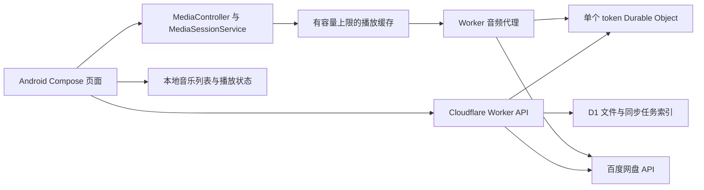

# 个人百度网盘音乐播放器设计草案

> 历史候选方案，已被用户随后要求的 Flutter 手机直连方案取代。当前实现计划见 `2026-10-28-flutter-direct-mvp.md`，不再需要 Cloudflare 或自建后台。

日期：2026-10-28。状态：候选设计，尚未实现；除“个人自用、连接自己的百度网盘”外，其余均为建议默认值。

## 目标与首版范围

一个安卓 App，浏览自己百度网盘指定目录中的音乐并连续播放。优先完成：服务地址及登录设置、授权状态提示、目录选择、音乐扫描、文件名搜索、播放/暂停/拖动、上一首/下一首、队列、收藏、后台播放、系统媒体控制、播放位置恢复和可设上限的播放缓存。

首版以文件名作为可靠的展示信息，时长和音乐标签在可获得时补全，缺少标签不阻止播放。批量补全专辑封面、歌词、完整离线下载管理、跨设备状态同步可在基本播放稳定后再做。

非功能目标：临时百度故障不丢授权；同步中断不误报音乐被删除；登录过期与网络错误能清楚区分；音乐大文件流式传输；缓存空间有明确上限；播放和鉴权日志不包含密钥及完整授权链接。

## ADR-001：客户端技术路线

候选方案：

| 方案 | 适用点 | 代价 |
| --- | --- | --- |
| Kotlin + Jetpack Compose + Media3，建议 | 需求目前只有安卓，可直接围绕系统媒体会话组织后台播放 | 需要 Android SDK 和原生构建环境 |
| Flutter + 原生播放插件 | 将来确实需要 iOS 时有跨端价值 | 仍需处理原生服务、鉴权和后台生命周期，增加一层集成 |
| 网页 WebView 包装 | 能较快复用参考界面 | 需要额外原生桥接才能满足完整后台播放和系统控制 |

建议使用原生安卓，暂定最低 Android 8.0（API 26）；实际 compileSdk/targetSdk 和依赖版本在搭建构建环境时锁定。这里没有声称本机已具备构建条件。

Media3 的 `MediaSessionService` 承载 Player 和 MediaSession，Compose 页面通过 MediaController 操作，避免把播放生命周期绑定到 Activity。官方依据：

```text
https://developer.android.com/media/media3/session/background-playback
```

## ADR-002：保留轻量后端

建议改造参考 Worker，保留一个管理员和一个网盘授权，百度应用 Secret 和刷新凭据只放服务端。相比把 Secret 写入 APK，这增加了部署和服务可用性的维护工作，但可以复用现有授权与文件索引基础。



该图表示逻辑模块，Service 不必运行在另一个 Android 进程。D1 保存远程文件索引与同步任务；本地保存展示所需列表、收藏、队列及播放位置，避免每次打开 App 都全量扫描网盘。

## ADR-003：先验证代理播放，再比较直连

默认候选：App 用稳定的文件 ID 访问 Worker 音频代理，由后端获取临时 dlink。好处是授权与恢复逻辑集中，App 不必持久化百度临时链接；代价是所有音频经过 Worker，实际网络路径和服务额度都需要评估。

另一候选：后端签发播放信息，手机直连百度下载端点，可减少中转，但必须验证请求头、重定向、token 暴露范围、链接失效恢复与移动网络可达性。不能仅凭参考代码就承诺此路线更快。

用同一批真实音乐测量代理和直连的起播时间、稳定吞吐、拖动成功率与失败恢复，再确定最终传输方式。缓存按稳定文件身份及内容版本标识；重新授权或切换账号时隔离缓存，不能用短期 dlink 当唯一缓存键。

## 授权与错误恢复

登录到自己的服务与授权百度网盘是两层状态，界面分别提示。参考 Cookie 会话可作为第一版兼容方案，但 API 客户端与 Media3 数据源必须明确共享会话；只向自己的服务附加会话，跨域重定向不转发服务凭据。

Cookie 或后续服务 token 的本地持久化使用系统安全存储能力保护；退出时清理本地凭据，修改密码后使旧会话立即失效。百度应用 Secret 不出现在 App、源码示例或日志中。

流式播放需要明确处理：Range/206、416、登录过期、授权失效、dlink 过期、限流、网络超时及服务端错误。可恢复故障保留队列和位置，并限制重试次数；真正需要重新授权时保留音乐库，提示用户处理。

## 扫描与音乐数据

开始同步时建立任务，持久化目录队列与分页进度，记录本轮发现的文件，允许分批继续。仅在任务完整成功后核对缺失文件。失败或被取消的扫描不将旧文件标记为已删除。远程树在扫描中变化时允许后续重扫收敛，不能把不稳定的 offset 当完整快照。

最小歌曲信息：远程文件 ID、路径、文件名、大小、修改时间/内容版本、可用状态。可选信息：标题、歌手、专辑、时长、封面。收藏、播放队列及历史属于用户状态，与远程目录同步分离。音乐管理首版只读取远端文件。

## 开发顺序与验收

1. 在独立的新项目中修复审查报告 R1–R6，并为真实故障分支建立回归检查。
2. 验证真实百度授权可读取用户音乐目录，取得一个有效 dlink；实测同一歌曲的起播、拖动和链接恢复。
3. 准备 Android SDK 及 Gradle Wrapper，建立 Compose 工程并生成可安装的调试 APK。
4. 串通登录、列表、搜索、单曲播放和队列，明确媒体请求鉴权。
5. 完成后台服务、系统媒体控制、音频焦点、耳机断开策略、播放位置恢复和缓存上限。
6. 在真机验证锁屏及切到其他 App 后继续播放；耳机按键能控制；来电/音频焦点变化符合设定；断网后能恢复；授权故障不清空音乐库；扫描失败不误标缺失。

构建成功、模拟请求通过和真机播放通过分别记录。当前仅完成参考项目审查及模拟复现，不能视为上述 App 验收已经完成。
